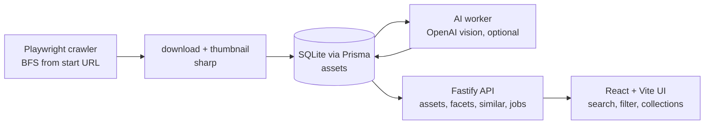

# ai-visual-asset-intelligence

Crawl a website for images, tag each one with a multimodal model, and search the resulting library by what the images actually show.

## Why

Collecting visual references across a site means opening page after page and saving images by hand, with no way to search them later by content. This pipeline crawls a start URL, downloads the images it finds, asks a vision model to describe each one (scene, room type, style, materials, colours, keywords), and stores that structured description so the library becomes searchable and filterable. The vision step is optional: without an API key the crawl, storage, and browsing still work, and tagging is simply disabled.

## Architecture



- **Crawler** (`apps/backend/src/crawler`, `workers/importWorker.ts`): headless Chromium walks pages breadth-first up to a depth and page cap, with a rate limit, extracting image URLs from `img`, `srcset`, `picture`, Open Graph, and CSS backgrounds. Originals and thumbnails are written with `sharp`.
- **Enrichment** (`workers/aiWorker.ts`): each image is sent to an OpenAI vision model, which returns a structured JSON tagging. A job queue drives this and only runs when `OPENAI_API_KEY` is set.
- **API** (`apps/backend/src/routes`): Fastify endpoints for search, facets, collections, jobs, and tag-overlap similarity.
- **UI** (`apps/frontend`): React and Vite client to search, filter by facets, inspect an asset, and group assets into collections.
- **Shared types** live in `packages/shared` and are consumed by both ends.

## Key decisions and trade-offs

- **SQLite with Prisma as the default store.** No database server to run; the schema is one `prisma migrate` away and swaps to Postgres by changing the datasource. The trade-off is no concurrent writers, which is fine for a single-operator tool.
- **AI is optional and degrades gracefully.** The backend starts the enrichment worker only when a key is present and otherwise reports "AI disabled", so the crawl and browse paths never depend on a paid API being configured.
- **Similarity is tag overlap, not embeddings.** "Similar" ranks assets by shared tags (room type, style, materials). This is cheap and explainable but will miss visual similarity that the tags do not capture. The code labels this honestly as a first phase; vector search is a deliberate next step, not a hidden gap.
- **Thumbnails on ingest.** Images are resized once at download time so the UI never serves full-resolution originals, trading a little disk for a responsive grid.
- **One vision call per image, not an agent.** Enrichment is a single structured-output request per image, not a multi-step tool-using loop. That keeps cost and latency predictable at the price of less adaptive tagging.

## Run locally

```bash
cd apps/backend && cp .env.example .env && cd ../..   # set OPENAI_API_KEY to enable tagging (optional)
npm install
npm run db:migrate      # creates the SQLite database and schema
npm run dev             # backend on :3000, frontend via Vite
```

Then open the frontend URL that Vite prints, enter a start URL, and start an import. Without an API key, assets are crawled and stored but not tagged.

Build everything with `npm run build` (shared, then backend `tsc`, then frontend `tsc` and Vite).

## Limitations and next steps

- Tag-overlap similarity is not semantic; adding image or text embeddings would make "similar" reflect appearance, not just shared labels.
- The crawler respects a depth, page cap, and rate limit, but does not read `robots.txt`; point it only at sites you are allowed to crawl.
- Enrichment quality is only as good as a single vision call; batching and a review step would raise precision.
- No automated quality metric ships yet; a small labelled set plus tag-precision scoring would let changes to the prompt be measured.
